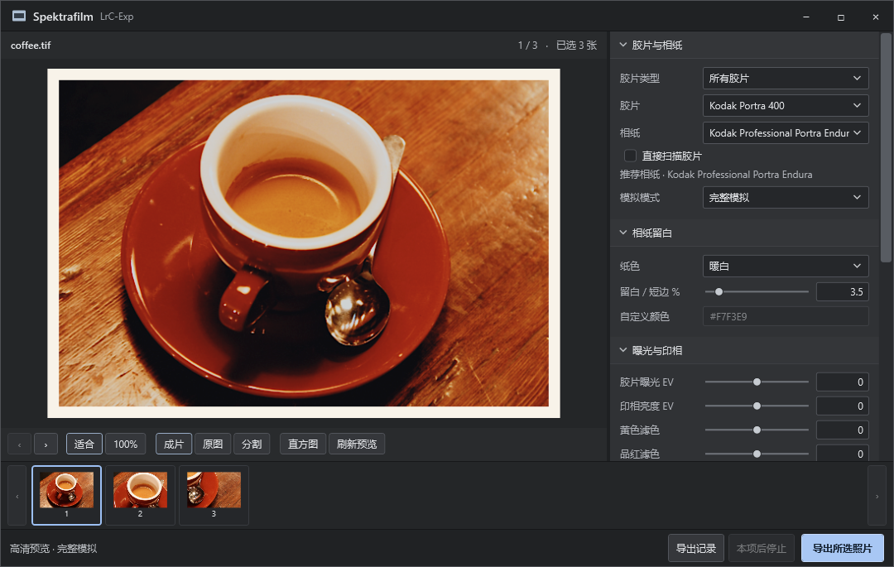
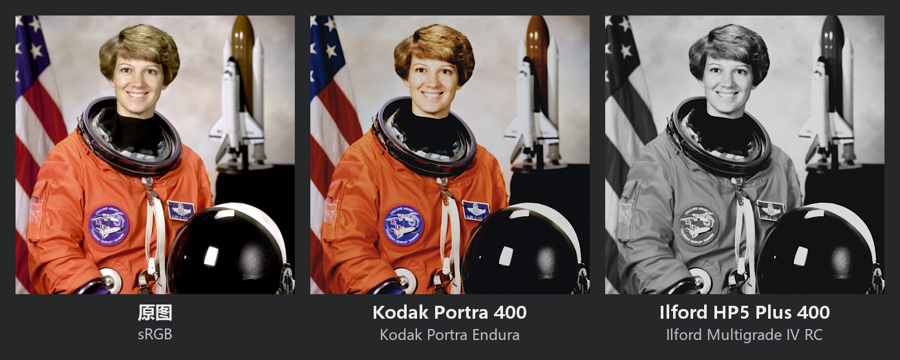
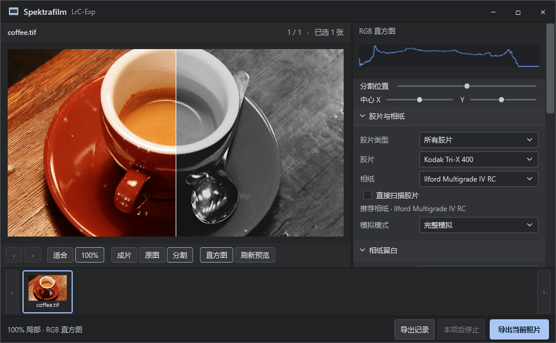
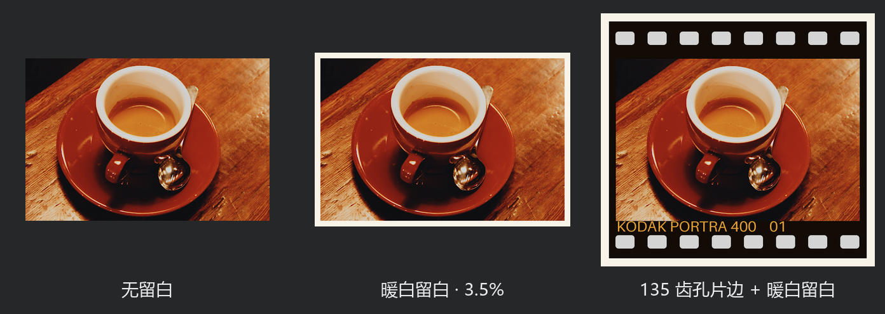

# Spektrafilm LrC-Exp

在 Windows 上用 Lightroom Classic 完成选片和基础调整，再在横向工作区内选择胶片、印相、检查细节并批量导出。当前发布版本为 **0.5.0**。工作区使用 Windows PowerShell 5.1 和 WPF。



图中使用 Kodak Portra 400 和 Kodak Portra Endura 相纸，右栏的「留白 / 短边 %」设为 3.5。

## 安装与更新

下载并完整解压 Windows x64 发布包。打开解压后的 `Spektrafilm-LrC-Exp` 文件夹，在 PowerShell 中运行安装脚本。首次安装需要联网下载 Python 3.13 和渲染依赖。[下载 v0.5.0 Windows x64 发布包](https://github.com/ainepadma/Spektrafilm-LrC-Exp/releases/download/v0.5.0/Spektrafilm-LrC-Exp-v0.5.0-Windows-x64.zip)

```powershell
.\scripts\setup.ps1
```

需要代理时可向脚本传入 `-Proxy http://127.0.0.1:端口`。在 LrC 的「文件 → 增效工具管理器」添加 `Spektrafilm.lrplugin`，保留它与 `workspace`、`assets`、`bridge`、`.venv` 的相对位置。通过「文件 → 增效工具选项（Plug-in Extras）→ Spektrafilm · 胶片模拟」打开浮窗。

从 0.4.x 或更早版本升级时，关闭旧浮窗，在增效工具管理器选中插件并重新加载即可。原有的项目 Python 环境可继续使用。首次导出可能编译 CPU 内核；安装脚本也可以提前完成编译。

## 横向工作区

工作区的标题栏、滑块、输入框、按钮和滚动条采用统一的深灰配色。左侧显示照片，底部胶片条用于切片。胶片、相纸、纸边、冲印参数、同步、导出目录和导出记录都在同一个窗口的右栏展开。可以直接输入或粘贴导出目录的绝对路径。

预览根据照片区域的实际显示像素及 Windows 缩放比例请求 16 位 LrC 图像，再生成无损 PNG。调整窗口大小会更新预览分辨率，最长边上限为 4096 像素。完整模拟保留颗粒和光晕，快速色彩沿用对应的快速配方。纸边和片门在主预览与常规导出中共用同一道成片处理。单张预览仅改变留白、日期或片门时，引擎可以复用已模拟的图像。

## 胶片与暗房



- **选择胶片和相纸。** 目录含 25 款拍摄胶片和 9 种印相介质，含黑白银盐、彩色负片、彩色反转片和电影正片印片。相纸列表按所选胶片匹配，切换胶片时优先选用其推荐相纸。反转片使用直接扫描，也可以给负片手动开启直扫。
- **调整冲印参数。** 展开右栏的冲印设置可以调整胶片曝光、印相亮度、黄／品红滤色和预闪。画幅按毫米设置。完整模拟支持颗粒、光晕、防光晕层、乳剂散射、亮部增强、染料偶合和相纸眩光。快速色彩使用固定配方生成查找表，适合以色调为主的批量输出。
- **成片调色。** 冲印后的曝光、对比、饱和度和黑白场作用于模拟结果。曲线支持 RGB、亮度及单独红绿蓝通道，可选择、添加、移动和删除控制点。分区调色独立控制整体、阴影、中间调和高光的色相、饱和度与亮度。
- **查看宽容度。** 「宽容度」比较当前胶片直扫、胶片＋相纸的中性灰阶响应，以及当前照片的场景亮度。介质范围取模拟响应的 5%–95%，场景范围取图像亮度的第 1 和第 99 百分位，以 18% 灰为 0 EV。可以采用测量建议或手动调整高光与阴影回收。该值是当前配方的计算结果。

## 浏览与逐张设置

- 单选时在当前筛选结果中浏览；多选时在选区内浏览。可以前后切片、给底部缩略图翻页或点击缩略图跳转。完成 LrC 曝光或裁切调整后，点击「刷新预览」。
- 「对比、直方图与 100% 局部」可查看 LrC 调整后图像、胶片结果或滑动分割线。局部模式取得原尺寸 TIFF，仅将所选区域和周围的光学计算余量送入引擎。检查模式直接在左侧画布显示单张 sRGB 胶片结果。点击「成片」即可返回整图，查看含相纸留边、拼版和日期的整张输出。
- 修改一张照片的胶片、相纸或暗房参数，会在项目的 `.runtime/photo-recipes` 中保存配方。记录按 LrC 目录路径和照片 ID 区分，包括虚拟副本。移动或重新命名目录后，需要重新关联原配方。可在「复制设置」「粘贴到当前」「同步到选区」中选择同步的参数组。
- 批量导出优先使用每张照片已保存的配方，未单独编辑的照片沿用当前配方。浮窗打开期间复用同一个渲染进程。首次渲染可能需要加载引擎或编译数值模块。



点击「100%」和「分割」，拖动「分割位置」就能比较同一处纹理。图中杯口左半保留原图，右半显示 Kodak Tri-X 400 在 Ilford Multigrade IV RC 相纸上的效果。右栏直方图统计当前局部的模拟结果。

## 相纸留白、片边与半格



- 「相纸留白」在成片四周留出等宽的纸面，可以选亮白、暖白、黑色或自定义色。自动印相采用暖白，每侧宽度默认为加边前图像短边的 3.5%，可在 0–30% 间调整或关闭。旧版逐张配方缺少纸边设置时同样采用自动模式。胶片直扫默认不留边，也可以手动指定纸色。相纸留边会随成片一起导出；指定输出长边时，尺寸包含留边。Cineon 底片保留其密度编码。
- 「胶片片边」提供 135、半格、XPan 和多种 120 片门，可调整齿孔、胶片名称、帧号、片边雾化与漏光。片门几何和边码由程序绘制，选择片门会按其比例取景。
- 日期背可单独使用，读取照片拍摄日期或快门、光圈、焦距，并支持位置、字号、亮度和边距。日期不可用时不会填入当前日期。
- 「半格双拼」将两张照片横排或竖排，可分别调整两格的曝光、缩放与偏移，也可调格间距。多选时按顺序两张一组，左右独立沿用各自配方。剩余的单张会在导出记录中标为跳过。

## 导出

「输出配方」可保存有名称的导出设置，包括目录、格式、JPEG 品质、自定义长边、色彩空间和文件命名。文件名模板支持 `{name}`、`{film}`、`{paper}`、`{date}`。同名文件可加后缀、跳过或覆盖已有成片。默认输出到项目内的 `exports`。可在当前照片完成后停止队列，并在「导出记录」查看每项结果。

常规输出支持 JPEG、8 位 PNG、8/16 位 TIFF，可选 sRGB、Display P3 或 ProPhoto RGB。渲染流程从 LrC 接收 16 位 ProPhoto RGB 中间图，按所选空间生成像素并嵌入相应 ICC。源照片的 EXIF、IPTC 和 XMP 不会整体复制到成片。

完整模拟使用并行 CPU 内核计算颗粒和扫描颜色响应。颗粒保持原模型的统计分布，每个像素的随机纹理可以与旧版不同。快速色彩通过编译后的插值和调色直接处理原尺寸像素。实际时间取决于图像尺寸、是否首次加载、配方和 LrC 生成 TIFF 所需时间。

同一浮窗连续导出时，插件最多保留四张、合计 384 MiB 的中间 TIFF。复用前会核对照片、编辑时间、源文件状态和输出尺寸。点击「刷新预览」可主动清除复用记录。导出记录分别显示准备 LrC 图像、渲染并写盘的耗时。

Cineon DI 使用负片显影后的密度生成对数编码，输出单张 16 位 TIFF。10 位 Cineon 标尺的参考黑为 95、参考白为 685，码值缩放到 16 位存储，不嵌入显示用 ICC。在支持 Cineon 的调色软件中按 Cineon Log 解释。它走独立的底片密度流程，不印相、不加片边或拼版。实现与参考程序的数值结果尚未逐像素比对。

## 验证与来源

```powershell
.\.venv\Scripts\python.exe -m unittest discover -s tests -p "test_*.py"
powershell.exe -NoProfile -STA -ExecutionPolicy Bypass -File .\tests\test_workspace_recipes.ps1
powershell.exe -NoProfile -STA -ExecutionPolicy Bypass -File .\tests\test_workspace_sidebar.ps1
```

Python 测试使用合成图验证物理配方、黑白响应、局部检查、画布、宽色域、双拼、Cineon、加速内核及文件写入。Lua 5.1 测试可从项目根目录运行 `tests/test_*.lua` 中的各脚本，覆盖浮窗、配方、选片和导出缓存。渲染错误日志在 `.runtime/logs` 下。

咖啡样片由 Rachel Michetti 拍摄，以 CC0 发布。胶片对照图使用 NASA 的 Eileen Collins 宇航员肖像，原照属于公有领域。示意图中的胶片效果由本项目渲染。[咖啡样片来源](https://scikit-image.org/docs/stable/api/skimage.data.html#skimage.data.coffee) · [NASA 肖像原照](https://flic.kr/p/r9qvLn)

模拟引擎由 Andrea Volpato 开发，项目依赖固定在提交 `3bb2c2d`。[spektrafilm](https://github.com/andreavolpato/spektrafilm)

扩展胶片与相纸数据取自 SpektraLab Windows 1.3.1 固定提交 `ee800f7`，原始 JSON 与来源说明位于 `assets/stocks`。其中 CineStill 800T 复用 Vision3 500T 数据并按该配置调整防光晕层；四款黑白片与 Ilford 相纸使用该版本的独立产品数据。[上游数据与署名](https://github.com/YZH2006517/SpektraLab-Windows-NANATATA/blob/ee800f74bb621019969cf1da1d828e61ed08e944/engine/resources_product/NOTICE.md)

LrC 集成使用 Adobe Lightroom Classic SDK。[Adobe 开发文档](https://developer.adobe.com/lightroom-classic/)
